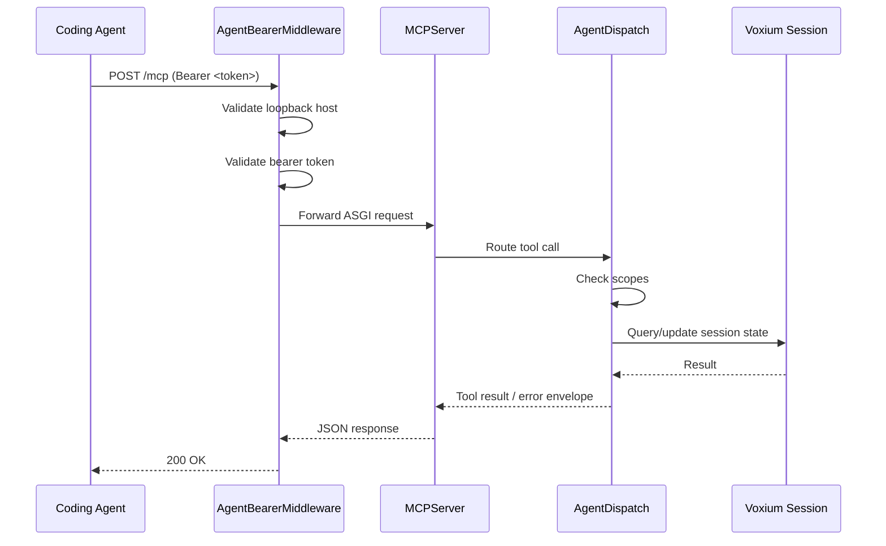

# Opt-in MCP control plane

The **opt-in MCP (Model Context Protocol) listener** exposes a local control-plane endpoint so that **coding agents** (e.g., terminal-based assistants) can query Voxium session state via a scoped, bearer-token-bearing endpoint. The listener is **off by default**, binds **only** to `127.0.0.1`, and requires a **bearer token**.

## Quick start

1. **Enable** the listener with `--agent` on the CLI or by setting `agent.enabled: true` in `~/.config/voxium/config.yaml`.
2. The credential file is written to `~/.config/voxium/run/agent.json` (mode `0600`). It contains the loopback URL and bearer token.
3. Use the bearer token as an `Authorization: Bearer <token>` header on all requests.

```bash
voxium run --agent
```

### Flag precedence

The following precedence determines whether the listener starts (highest wins):

1. **CLI** — `--agent` (enable) or `--no-agent` (disable)
2. **Environment** — `VOXIUM_AGENT=1` / `true` / `yes` (also `0` / `false` / `no` to disable)
3. **YAML config** — `agent.enabled: true` in `~/.config/voxium/config.yaml`
4. **Hardcoded default** — `false` (off)

The resolver is a pure function in ``voxium.agent_resolve`` (``resolve_agent_enabled``) and
is unit-tested in ``tests/test_agent_resolve.py``.

## Listener startup

When enabled, Voxium:

1. **Installs a NullHandler guard** on the root logger (prevents `mcp` SDK from adding extra console handlers via `logging.basicConfig`).
2. **Binds** a TCP socket on `127.0.0.1:0` (OS-assigned random port).
3. **Serves** an MCP `streamable_http_app` over the socket using **uvicorn** on a dedicated daemon thread.
4. **Writes** the credential file (`~/.config/voxium/run/agent.json`) with mode `0o600`.
5. **Registers** the tools allowed by the granted scopes (see [Tool registry](#tool-registry)). With the default scopes that is session status, transmission records, and history reads.

If any step fails (e.g., `mcp` not installed, bind error, file write failure), the client **logs neutrally and continues** — the MCP listener is **best-effort** and never blocks the primary PTT path.

### Stopping

On normal exit (`Ctrl+C`), the listener socket is closed and the thread is joined with a 5-second timeout.

## Security boundaries

| Boundary | Rule |
|----------|------|
| **Bind address** | `127.0.0.1` only — rejected at middleware level |
| **Query-string tokens** | Rejected — `token=...` in the query string returns `403` |
| **Bearer validation** | Constant-time comparison via `hmac.compare_digest` |
| **Credential file** | Mode `0o600` (Linux) or Windows DACL; fails silently if write fails |
| **Logs** | Tokens are redacted by the `agent_logging` guard; no PII or transcript data |
| **Transcript persistence** | MCP session is **in-memory only** — no disk writes |

## Scope system

Each tool requires a set of scopes. A tool is registered only when every scope it needs is granted.

- `status:read` — session state
- `transcript:read` — transmission records and the in-RAM history list
- `clipboard:write` — system clipboard
- `output:paste` — paste a history line into the active window
- `input:ptt` — engage and release PTT
- `input:vox` — switch between PTT and VOX
- `session:retransmit` — re-transmit the pending F6 capture
- `debug:read` — health, stats, and disk report
- `logs:read` — reserved. `debug_logs` is in the catalog but is **not** registered on the listener

By default (no YAML `agent.scopes` list) the listener grants ``status:read`` and ``transcript:read``.

Grant more scopes in ``~/.config/voxium/config.yaml``:

```yaml
agent:
  enabled: true
  scopes:
    - status:read
    - transcript:read
    - input:ptt
    - input:vox
    - session:retransmit
  # Optional. Absent keeps the 120 second agent VOX cap.
  # Present but not an integer from 1 to 3600 rejects VOX arm.
  vox_max_seconds: 120
```

The listener does not reject unknown scope names. A name that is not in the table above simply matches no tool, and that tool stays off the manifest. The PTT path still starts.

## Tool registry

| Tool | Purpose | Scopes |
|------|---------|--------|
| `session_status` | State, input mode, inflight flags, latest transmission id | `status:read` |
| `transmission_last` | Most recent transmission record | `transcript:read` |
| `transmission_get` | One transmission record by id | `transcript:read` |
| `transmission_wait` | Long-poll until that transmission finishes | `transcript:read` |
| `history_list` | Recent history previews (newest is `#1`) | `transcript:read` |
| `history_get` | One history entry, full text | `transcript:read` |
| `clipboard_set` | Put text on the system clipboard | `clipboard:write` |
| `history_copy` | Copy one history entry to the clipboard | `clipboard:write`, `transcript:read` |
| `paste_history` | Paste one history line, or advance the replay cycle | `output:paste`, `transcript:read` |
| `ptt_engage` | Open the mic (PTT mode, station idle) | `input:ptt` |
| `ptt_release` | Drop the carrier and start transcription | `input:ptt` |
| `input_mode_set` | Arm or disarm VOX. Agent arm starts a dead-man timer (default 120 s, cap `vox_max_seconds`). The mode hotkey back to PTT cancels that timer | `input:vox` |
| `retransmit_last` | Re-transmit the pending capture (same buffer as F6) | `session:retransmit` |
| `debug_health` | Loopback server health. Uses the client's server URL | `debug:read` |
| `debug_stats` | Persistent counters and server `/stats` | `debug:read` |
| `debug_disk` | Repo data-directory sizes | `debug:read` |

Mutating tools are refused while the station is recording, transcribing, or already running a retransmit. `ptt_engage` while already recording returns success with `already_recording: true` and does not open a second mic.

## Dependency policy

The `mcp` SDK is an **optional extra**: `pip install "voxium[agent]"` installs `mcp>=2.3,<3`. If the SDK is missing, the listener silently fails to start and Voxium operates normally without the agent endpoint.

## Architecture



## Troubleshooting

- **"MCP agent listener failed to start"**: Check that `mcp` is installed (`.venv/bin/pip install mcp`) and that `--agent` is passed or the config flag is set. Inspect the full traceback in the Voxium CLI log.
- **Credential file missing**: The listener may have failed to bind; check the port was available and that `~/.config/voxium/run/` is writable.
- **403 on requests**: Ensure you are using the correct bearer token from `agent.json` and sending it as `Authorization: Bearer <token>` (not as a query parameter).
- **Non-loopback connections blocked**: The middleware explicitly rejects requests to hosts other than `127.0.0.1`, `localhost`, or `::1`.
