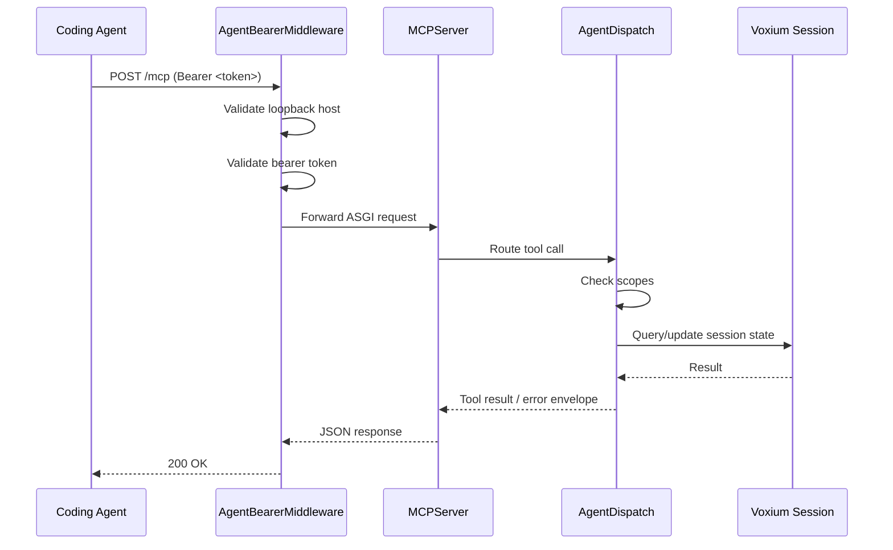

# Opt-in MCP control plane

The **opt-in MCP (Model Context Protocol) listener** exposes a local control-plane endpoint so that **coding agents** (e.g., terminal-based assistants) can query Voxium session state and trigger PTT operations. The listener is **off by default**, binds **only** to `127.0.0.1`, and requires a **bearer token**.

## Quick start

1. **Enable** the listener with `--agent` on the CLI or by setting `agent.enabled: true` in `~/.config/voxium/config.yaml`.
2. The credential file is written to `~/.config/voxium/run/agent.json` (mode `0600`). It contains the loopback URL and bearer token.
3. Use the bearer token as an `Authorization: Bearer <token>` header on all requests.

```bash
voxium run --agent
```

### Flag precedence

The following precedence determines whether the listener starts (highest wins):

1. **CLI** — `--agent` (enable) or `--no-agent` (disable)
2. **Environment** — `VOXIUM_AGENT=1` / `true` / `yes`
3. **YAML config** — `agent.enabled: true` in `~/.config/voxium/config.yaml`
4. **Hardcoded default** — `false` (off)

## Listener startup

When enabled, Voxium:

1. **Installs a NullHandler guard** on the root logger (prevents `mcp` SDK from adding extra console handlers via `logging.basicConfig`).
2. **Binds** a TCP socket on `127.0.0.1:0` (OS-assigned random port).
3. **Serves** an MCP `streamable_http_app` over the socket using **uvicorn** on a dedicated daemon thread.
4. **Writes** the credential file (`~/.config/voxium/run/agent.json`) with mode `0o600`.
5. **Registers** only the `session_status` tool (returns current state, input mode, and latest transmission ID).

If any step fails (e.g., `mcp` not installed, bind error, file write failure), the client **logs neutrally and continues** — the MCP listener is **best-effort** and never blocks the primary PTT path.

### Stopping

On normal exit (`Ctrl+C`), the listener socket is closed and the thread is joined with a 5-second timeout.

## Security boundaries

| Boundary | Rule |
|----------|------|
| **Bind address** | `127.0.0.1` only — rejected at middleware level |
| **Query-string tokens** | Rejected — `token=...` in the query string returns `403` |
| **Bearer validation** | Constant-time comparison via `hmac.compare_digest` |
| **Credential file** | Mode `0o600` (Linux) or Windows DACL; fails silently if write fails |
| **Logs** | Tokens are redacted by the `agent_logging` guard; no PII or transcript data |
| **Transcript persistence** | MCP session is **in-memory only** — no disk writes |

## Scope system

Each tool requires a set of scopes. The current scope set is:

- `status:read` — read session state
- `transcript:read` — read transcription results
- `clipboard:write` — write to the system clipboard
- `output:paste` — paste output to an active window
- `input:ptt` — trigger PTT recording
- `input:vox` — trigger VOX (open-mic) recording
- `session:retransmit` — re-transmit (F6) the last capture
- `debug:read` — read internal debugging state
- `logs:read` — read CLI log entries

## Tool registry

Currently registered tools:

| Tool | Purpose | Scopes |
|------|---------|--------|
| `session_status` | Returns current session state, input mode, and latest transmission ID | `status:read` |

Future tools (PRs 5+) may add PTT trigger, VOX trigger, and replay capabilities.

## Dependency policy

The `mcp` SDK is an **optional extra**: `pip install "voxium[agent]"` installs `mcp>=2.3,<3`. If the SDK is missing, the listener silently fails to start and Voxium operates normally without the agent endpoint.

## Architecture



## Troubleshooting

- **"MCP agent listener failed to start"**: Check that `mcp` is installed (`.venv/bin/pip install mcp`) and that `--agent` is passed or the config flag is set. Inspect the full traceback in the Voxium CLI log.
- **Credential file missing**: The listener may have failed to bind; check the port was available and that `~/.config/voxium/run/` is writable.
- **403 on requests**: Ensure you are using the correct bearer token from `agent.json` and sending it as `Authorization: Bearer <token>` (not as a query parameter).
- **Non-loopback connections blocked**: The middleware explicitly rejects requests to hosts other than `127.0.0.1`, `localhost`, or `::1`.
