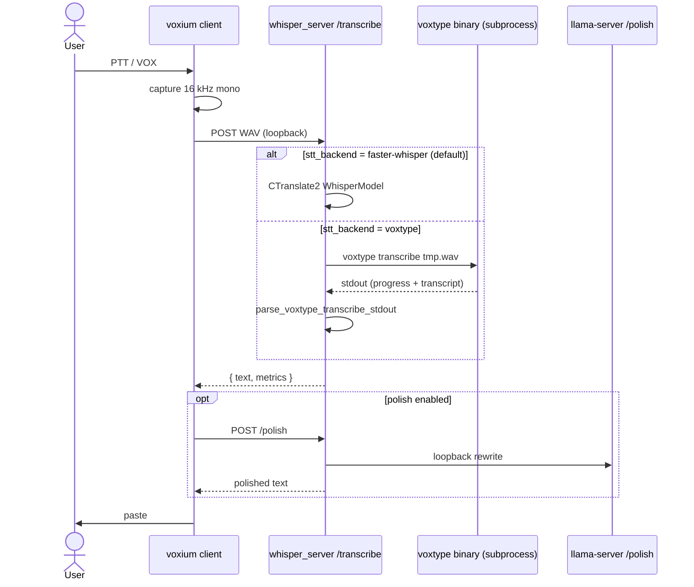

# Ticket: optional Voxtype STT backend behind `/transcribe`

**Status:** agent-ready implementation ticket. No code shipped yet.  
**GitHub:** https://github.com/chris-piekarski/voxium-ptt/issues/17  
**Branch:** `feat/voxtype-stt-backend`  
**PR title:** `feat: optional voxtype STT backend behind /transcribe`  
**Audience:** a coding agent implementing this in `voxium-ptt`. Treat this file as the spec. Do not invent a second architecture.

> Brand note: operator-facing copy stays radio + local-stack ([docs/brand.md](../brand.md)). JSON keys, errors, CLI flag names stay **neutral**. Frame Voxtype as an optional **local decoder on the loopback hop**, not a new product and not a cloud path.

**Upstream studied:** [peteonrails/voxtype](https://github.com/peteonrails/voxtype) `dev` @ v1.0.1 (MIT). Clone is **not** vendored into this repo.

---

## 0. One-sentence outcome

Add an **opt-in, Linux-first** STT backend so `POST /transcribe` can decode a WAV via a local `voxtype` binary, while the Voxium client, PTT/VOX HUD, loopback gate, polish, chatter, and paste path stay unchanged. Default remains **faster-whisper**.

---

## 1. Goals and non-goals

### 1.1 Goals

- Keep the existing client contract: `transcribe_server()` in `src/voxium/app.py` still `POST`s a WAV to a **loopback** URL and reads `{text, metrics}`.
- Add `stt_backend: faster-whisper | voxtype` (default `faster-whisper`).
- When `voxtype`: the Voxium server shells out to a **local** `voxtype` binary, maps stdout to the existing `/transcribe` JSON, then the client still runs `/polish` as today.
- Skip CTranslate2 / faster-whisper **model load and warmup** when the backend is `voxtype` (VRAM / startup).
- Disable `/transcribe-stream` when the backend is `voxtype` (that WebSocket reuses the in-process `WhisperModel`; see [live-transcribe-stream.md](live-transcribe-stream.md) §1.2).
- Fail loudly and actionably if the binary is missing, the engine is cloud (`soniox`), or the platform is Windows.
- Unit-test the parser and CLI wiring **without** a real Voxtype install. Optional integration test if `voxtype` is on `PATH`.

### 1.2 Non-goals (this ship)

- Vendoring Voxtype source, Cargo builds, or git submodules.
- Replacing `voxium run`, the radio TUI, PTT/VOX, hotkeys, or paste.
- Using the **Voxtype daemon** (`voxtype` / `voxtype record start|stop`) — that owns the mic and would fight Voxium capture.
- Cloud STT: `engine=soniox`, `whisper.mode=remote` pointed off-box, OpenAI, etc.
- Windows support (Voxtype is Linux/macOS; refuse with a fix-it message).
- Live partials / eager processing / meeting mode from Voxtype.
- Shipping a Voxtype model catalog inside `TRUSTED_MODELS`.
- Persistent warm Voxtype worker (each take currently cold-loads; see §4.3). Call that v2.
- Changing the polish / llama.cpp lane.

### 1.3 Definitions

| Term | Meaning |
|------|---------|
| **STT backend** | Who decodes the WAV inside Voxium's `/transcribe` handler. |
| **faster-whisper** | Current in-process CTranslate2 path (`get_model` → `whisper.transcribe`). **Default.** |
| **voxtype backend** | Subprocess to a local `voxtype` binary; audio never leaves loopback/this machine. |
| **Voxtype daemon** | Full PTT app. **Out of scope.** Do not start it. |
| **Authoritative paste text** | Still batch `/transcribe` → optional `/polish` → paste. |

---

## 2. Why this fits (and where it does not)

Voxium is already a three-hop loopback pipeline ([architecture.md](../architecture.md)):

```
client (PTT/VOX, HUD, paste) → POST /transcribe → optional POST /polish → paste
```

`transcribe_server()` (`src/voxium/app.py`, ~3110) does **not** import faster-whisper. The server owns decode. Voxtype belongs **only** in that middle hop.

Voxtype is a Rust desktop dictation app. Its useful surface for us is the **one-shot file CLI**, not the daemon:

```text
voxtype [--engine ENGINE] [--model MODEL] transcribe /path/to.wav
```

Source of truth (upstream `src/app/transcribe_file.rs`):

- Input: WAV (int or float). Mixed to mono, resampled to **16 kHz** if needed.
- Voxium already captures **16 kHz mono PCM** (`SAMPLE_RATE = 16_000` in `src/voxium/constants.py`) and writes a WAV in `/transcribe`.
- The CLI **prints progress on stdout**, then a blank line, then the transcript. There is **no `--json` flag** on `transcribe`.
- Hidden `voxtype transcribe-worker` speaks a JSON stdin protocol but is **Whisper-only**. v1 uses `transcribe` so every compiled engine works. Worker protocol is v2.

**Cold start:** `transcribe_file` calls `create_transcriber()` per invocation. Every take reloads the model. Document this in `/health`, CLI help, and README. Do not pretend it is as fast as a warm CTranslate2 resident model.

---

## 3. Current Voxium seams (do not bypass)

| Seam | File | What the agent must preserve |
|------|------|------------------------------|
| Client POST | `src/voxium/app.py` `transcribe_server()` | Loopback check; `files={"file": wav}`; `result["text"]`; `metrics` stash |
| HTTP route | `src/voxium/whisper_server.py` `POST /transcribe` ~1559 | Status codes; `{text, language, model, segments, duration, metrics}` |
| Model allow-list | `src/voxium/model_registry.py` | **Unchanged for faster-whisper.** Must **not** run `validate_model_name` on Voxtype model ids |
| Config defaults | `src/voxium/app.py` `_apply_transcription_model_defaults` | Today invalid `transcription.model` falls back to `small.en`. That would **wipe** Voxtype ids like `cohere-transcribe-q4f16`. Must be backend-aware |
| Server spawn | `src/voxium/local_server_cmd.py` | New flags must be forwarded from `voxium run` → child `voxium server` |
| Health | `whisper_server.health()` ~1230 | Add backend fields; do not lie about loaded CTranslate2 models |
| Streaming | `_register_streaming_routes` | Off when backend is voxtype |
| Warmup | `ensure_stt_model_ready` ~1076 | **Skip** when backend is voxtype |
| Tests/lint | `AGENTS.md` | `make test` + `make lint` required to merge |

Capture format already matches Voxtype: 16 kHz mono WAV, written to a temp file inside `/transcribe` before infer.

---

## 4. Architecture (v1)



### 4.1 New modules (keep `whisper_server.py` thin)

Do **not** dump subprocess logic into `whisper_server.py` (it is mypy-ignored and omitted from coverage). Put testable code in new modules:

| Module | Role |
|--------|------|
| `src/voxium/stt_backend.py` | Backend name constants, validation, `SttResult` dataclass |
| `src/voxium/voxtype_cli.py` | Binary resolve, argv, subprocess, **stdout parser**, timeout, errors |
| `tests/test_stt_backend.py` | Enum / validation |
| `tests/test_voxtype_cli.py` | Parser goldens + argv + mocked subprocess |

`whisper_server.py` only: switch on `config.stt_backend` inside `transcribe()`, skip warmup, extend `/health`.

### 4.2 Subprocess contract (pinned)

Resolve binary in this order:

1. CLI `--voxtype-bin` / config `transcription.voxtype.binary` if set
2. `shutil.which("voxtype")`
3. Else: `503` with “install voxtype and put it on PATH, or set transcription.voxtype.binary”

**Forbidden engines** (reject at config/CLI parse and again before spawn): `soniox`.

**Forced local whisper mode:** when engine is `whisper` or unset, always pass `--whisper-mode local` so a user `~/.config/voxtype/config.toml` with `backend = "remote"` cannot send Voxium audio off-box.

Suggested argv:

```text
<bin> -q --whisper-mode local transcribe <wav>
# plus optional:
#   --engine <engine>
#   --model <model>
#   --language <lang>   if Voxium config.language is set
```

`-q` quiets tracing; `transcribe_file.rs` still `println!`s progress. **Parser is mandatory.** Timeout = server `--timeout` (default 120s). Kill the process group on timeout.

Exit handling:

| Voxtype result | Voxium `/transcribe` |
|----------------|----------------------|
| exit 0, transcript non-empty | 200, `text` = parsed string |
| exit 0, “No speech detected, skipping transcription.” | 200, `text` = `""` (same as Voxium speech guards returning empty) |
| exit 0, empty after parse | 200, `text` = `""` |
| non-zero / timeout / missing binary | 500/503 with stderr tail; `stats.record_error()` |

Never raise through uncaught subprocess exceptions; map them to `HTTPException` like the current faster-whisper failure path.

### 4.3 Stdout parser (pinned; golden-test this)

Upstream `src/app/transcribe_file.rs` prints, in order:

```text
Loading audio file: "..."
Audio format: 16000 Hz, 1 channel(s), Int
Resampling from N Hz to 16000 Hz...     # optional
Processing N samples (X.XXs)...
VAD: X.XXs speech (Y% of audio)         # optional
No speech detected, skipping transcription.   # early return, no transcript
<blank line>
<transcript, may be multiple lines>
```

`parse_voxtype_transcribe_stdout(stdout: str) -> str`:

1. Normalize newlines to `\n`.
2. If any line equals (strip) `No speech detected, skipping transcription.` → return `""`.
3. Drop lines whose stripped form starts with any of:
   - `Loading audio file:`
   - `Audio format:`
   - `Resampling from `
   - `Processing `
   - `VAD:`
4. Strip leading/trailing blank lines from the remainder.
5. Return the remainder (preserve internal newlines). `""` if nothing left.

Do **not** “take the last line only” — transcripts can be multi-line.

Goldens live as string fixtures in `tests/test_voxtype_cli.py` (no audio files required).

### 4.4 `/transcribe` JSON when backend is voxtype

Keep the same top-level keys the client already reads. Fill honestly:

```json
{
  "text": "<parsed>",
  "language": "<--language or voxtype unknown>",
  "language_probability": null,
  "model": "<id passed to voxtype, or 'voxtype-config'>",
  "model_repo": null,
  "segments": [],
  "duration": <wav seconds if known, else null>,
  "metrics": {
    "request_id": "...",
    "input_bytes": N,
    "audio_seconds": ...,
    "transcription_seconds": <wall around subprocess>,
    "total_request_seconds": ...,
    "realtime_factor": ...,
    "output_chars": ...,
    "segments": 0,
    "capture": <existing parse_capture_metadata>,
    "model": {
      "name": "<model>",
      "backend": "voxtype",
      "engine": "<engine or null>"
    },
    "gpu": <GpuMetricsSampler around the subprocess is OK>
  }
}
```

Do **not** invent faster-whisper fields (`avg_logprob`, `decoder_tokens`, `model_repo` Systran paths). Empty `segments` is fine; client paste uses `text`.

GPU sampler around the subprocess is allowed (process-level nvidia-smi still works). If the probe is unavailable, `gpu` is null as today.

### 4.5 `/health` additions

Always include:

```json
"stt_backend": "faster-whisper" | "voxtype"
```

When `voxtype`:

```json
"voxtype": {
  "binary": "/usr/bin/voxtype",
  "version": "<stdout of voxtype -V, or null>",
  "engine": "whisper",
  "model": "base.en",
  "reachable": true
}
```

- `loaded_transcribe_models` / `warmed_transcribe_models` stay `[]`.
- `faster_whisper` may be `null`.
- `streaming_enabled` is `false`.
- Probe version once at startup (`voxtype -V` or `--version`); do not spawn Voxtype on every `/health`.

When `faster-whisper`, omit `voxtype` or set it `null`.

### 4.6 Startup

`whisper_server.main` after `ServerConfig` is built:

- If `stt_backend == "voxtype"`:
  - Resolve binary; `sys.exit(1)` with actionable text if missing.
  - Reject Windows (`sys.platform == "win32"`).
  - Reject `soniox`.
  - **Do not** call `ensure_stt_model_ready`.
  - Do **not** register streaming routes (pass `streaming_endpoint_enabled=False` or skip `_register_streaming_routes`).
  - Log: backend, binary, engine, model, and a one-liner that each take reloads the Voxtype model.
- Else: existing faster-whisper warmup unchanged.

---

## 5. Config, CLI, env

### 5.1 YAML (`~/.config/voxium/config.yaml`)

`VoxiumUserConfig.transcription` is already an open `dict`. Document these keys (no Pydantic nested model required unless it stays simple):

```yaml
transcription:
  backend: faster-whisper    # or voxtype
  model: small.en            # Systran id; used only for faster-whisper
  language: en               # optional; forwarded as --language
  voxtype:
    binary: voxtype          # path or name on PATH
    engine: whisper          # optional; one of the local allow-list
    model: null              # optional; if null, do not pass --model (use Voxtype's own config)
    timeout_seconds: 120     # optional; else server timeout
```

**Local engine allow-list** (copy from Voxtype `ENGINE_NAMES_CSV` minus cloud):

`whisper`, `parakeet`, `moonshine`, `sensevoice`, `paraformer`, `dolphin`, `omnilingual`, `cohere`, `openvino`

Reject `soniox`.

### 5.2 CLI flags

Add to **both** `add_run_options` (`voxium run`) and `add_server_options` / `whisper_server.main` (`voxium server`), and forward via `LocalServerLaunchConfig` + `argv_after_interpreter`.

| Flag | Default | Notes |
|------|---------|--------|
| `--stt-backend` | `faster-whisper` | Choices: `faster-whisper`, `voxtype`. Env: `VOXIUM_STT_BACKEND` |
| `--voxtype-bin` | unset | Path/name. Env: `VOXIUM_VOXTYPE_BIN` |
| `--voxtype-engine` | unset | Optional engine override |
| `--voxtype-model` | unset | Optional; **does not** go through `trusted_model_arg` |

`--model` / `-m` stays `trusted_model_arg` for faster-whisper. When backend is `voxtype`, `--model` is **ignored for decode** (avoids forcing `small.en` onto Cohere). Operators set `--voxtype-model` or leave Voxtype config in charge.

Help text must say: Voxtype is optional, local, Linux/macOS, each take reloads the model, not the Voxtype daemon.

### 5.3 Critical: `_apply_transcription_model_defaults`

Today (`app.py` ~365) any non-Systran `transcription.model` is replaced with `DEFAULT_MODEL_NAME`. That is correct for faster-whisper and **wrong** if someone puts a Voxtype model there.

v1 rule:

- `transcription.model` remains the **Systran** id for faster-whisper only; keep the current fallback.
- Voxtype model lives **only** in `transcription.voxtype.model` / `--voxtype-model`.
- Do not validate Voxtype model ids against `TRUSTED_MODELS`.

### 5.4 Slash / models

Minimal v1:

- `/health` already dumps server JSON — new fields show up. Optionally one line in `slash_commands` health formatter for `stt_backend`.
- `/models transcribe use <systran-id>` stays Systran-only. Do **not** teach it Voxtype catalogs in v1.
- `/help` one bullet: STT backend is selected at launch (`--stt-backend`), not via `/models`.

---

## 6. File-level change list

| File | Change |
|------|--------|
| `src/voxium/stt_backend.py` | **New.** `FASTER_WHISPER`, `VOXTYPE`, `parse_stt_backend()`, `LOCAL_VOXTYPE_ENGINES`, `SttResult` |
| `src/voxium/voxtype_cli.py` | **New.** resolve, argv, parse stdout, `run_voxtype_transcribe(wav_path, ...) -> SttResult` |
| `src/voxium/whisper_server.py` | `ServerConfig.stt_backend` (+ voxtype fields); branch in `transcribe()`; skip warmup; health; argparse |
| `src/voxium/local_server_cmd.py` | New fields + argv flags |
| `src/voxium/constants.py` | Optional env default `VOXIUM_STT_BACKEND` |
| `src/voxium/app.py` | `add_run_options` / `add_server_options` flags; pass through to `LocalServerLaunchConfig` |
| `src/voxium/slash_commands.py` | Health readout includes backend if easy |
| `README.md` | Short “optional Voxtype backend (Linux)” subsection |
| `docs/architecture.md` | One paragraph + diagram note that STT is pluggable |
| `docs/README.md` | Link this plan |
| `tests/test_stt_backend.py` | **New** |
| `tests/test_voxtype_cli.py` | **New** — parser goldens, argv, timeout mock |
| `tests/test_local_server_cmd.py` | Assert `--stt-backend voxtype` forwarded |
| `tests/test_server_health.py` | `stt_backend` in `/health` body (faster-whisper default) |
| `tests/test_cli_argv.py` / `test_cli_wiring.py` | Flags parse if those modules cover run/server argv |

Do **not** add Voxtype as a Python dependency in `pyproject.toml`.

---

## 7. Tests the agent must add

All default-path tests; no network; no real Voxtype required.

1. **Parser goldens** (`test_voxtype_cli.py`):
   - Typical whisper stdout → transcript `"Hello world"`
   - Multi-line transcript preserved
   - `No speech detected...` → `""`
   - Resample + VAD lines ignored
   - Empty remainder → `""`
2. **argv builder:** engine/model/language omitted when None; `--whisper-mode local` always present; `soniox` raises `ValueError`
3. **subprocess mock:** `run_voxtype_transcribe` with `monkeypatch` on `subprocess.run` / `Popen` returns parsed text; non-zero → exception type the server maps to 500
4. **timeout:** fake hang → timeout error
5. **`parse_stt_backend`:** aliases `faster-whisper`, `faster_whisper` → canonical; unknown → `ValueError`
6. **`local_server_cmd`:** voxtype flags appear; faster-whisper path does not require them
7. **health:** existing test still passes; new assertion `body["stt_backend"] == "faster-whisper"` when unset

Optional (skip if binary missing):

```python
@pytest.mark.skipif(shutil.which("voxtype") is None, reason="voxtype not installed")
def test_voxtype_binary_version_probe():
    ...
```

Do not call a real model in CI.

---

## 8. Implementation order (do this in order)

1. `stt_backend.py` + tests.
2. `voxtype_cli.py` parser + argv + tests (no spawn).
3. Subprocess runner + mocked tests.
4. `ServerConfig` + argparse on `voxium server` + `local_server_cmd` forwarding + `voxium run` flags.
5. Branch `POST /transcribe`; skip warmup; force streaming off.
6. `/health` fields.
7. Slash health one-liner if cheap.
8. README + architecture + this status line → “implemented, see code”.
9. `make test` and `make lint`. Fix what you broke (`_apply_transcription_model_defaults` tests must still pass).

Do not start by editing `app.py` paste/PTT logic.

---

## 9. Operator copy (when you touch README)

Keep it short. Suggested facts, radio-flavored but actionable:

- Default stack is still local faster-whisper on loopback.
- `--stt-backend voxtype` uses a **local** Voxtype binary for decode only. Install Voxtype yourself; Voxium does not bundle it.
- Linux (macOS if `voxtype` is on `PATH`). Not supported on Windows.
- Each take reloads the Voxtype model — slower than a warm Voxium server.
- Do not run the Voxtype daemon at the same time (mic + GPU fight).
- Cloud Voxtype engines (`soniox`, remote Whisper) are rejected.

License: Voxtype is MIT. We depend on it as an **optional runtime binary**, not as copied source. No extra NOTICE file required unless you copy files; do not copy files.

---

## 10. Acceptance criteria

- [ ] `voxium run` with default flags behaves as today (faster-whisper, streaming still registered, warmup still runs).
- [ ] `voxium server --stt-backend voxtype` does not import/load CTranslate2 models (no `ensure_stt_model_ready`).
- [ ] Same flag without a binary: process exits non-zero with an install/PATH message (not a traceback).
- [ ] `--stt-backend voxtype --voxtype-engine soniox` rejected at parse.
- [ ] `--whisper-mode local` is always on the Voxtype argv for whisper.
- [ ] Client still pastes `text` from `/transcribe` and still posts `/polish` when polish is on.
- [ ] `/transcribe-stream` is not registered (404) on a voxtype server.
- [ ] `/health` reports `stt_backend`.
- [ ] Windows: voxtype backend refused at server start.
- [ ] `make test` and `make lint` green.
- [ ] No Voxtype source in the tree; no new runtime Python deps.

---

## 11. Risks and how to handle them

| Risk | Handling |
|------|----------|
| Stdout format drift in a future Voxtype | Parser is isolated + goldens; log raw stdout at DEBUG on parse-empty-with-exit-0; README pin “tested against voxtype 1.0.x file CLI” |
| Multi-second per-take latency | Document; do not hide. v2 = persistent worker |
| GPU VRAM clash with polish llama.cpp | Operator problem; log a warning that two local GPU runtimes may contend |
| Operator also running `voxtype` daemon | Document “do not”; we never start it |
| `small.en` stomping Voxtype models | Separate `--voxtype-model` (see §5.3) |
| Hidden `transcribe-worker` is cleaner JSON | Whisper-only; defer to v2 |

---

## 12. v2 (explicitly not this ticket)

- Persistent Voxtype worker or upstream `--output json` on `transcribe`.
- `transcribe-worker` stdin protocol for whisper-only JSON.
- Voxtype model catalog in `/models`.
- Wayland `wtype` paste (separate ticket; that is output, not STT).
- macOS CI.

---

## 13. Upstream references (for the agent; do not re-litigate)

| Path in peteonrails/voxtype | Why it matters |
|-----------------------------|----------------|
| `src/app/transcribe_file.rs` | File CLI + stdout shape |
| `src/cli/commands.rs` `Commands::Transcribe` | `voxtype transcribe <file> [--engine]` |
| `src/cli/mod.rs` `ENGINE_NAMES_CSV` | Engine names including `soniox` |
| `src/transcribe/mod.rs` `create_transcriber` | Engine factory; local vs remote vs onnx |
| `src/transcribe/worker.rs` | JSON worker (whisper-only, v2) |
| `src/cli/root.rs` `--whisper-mode`, `--model`, `-q` | Flags we pass |
| `LICENSE` | MIT |

Voxium already captures 16 kHz mono and writes a temp WAV in `POST /transcribe` before infer — reuse that path; do not recapture audio in the backend.
